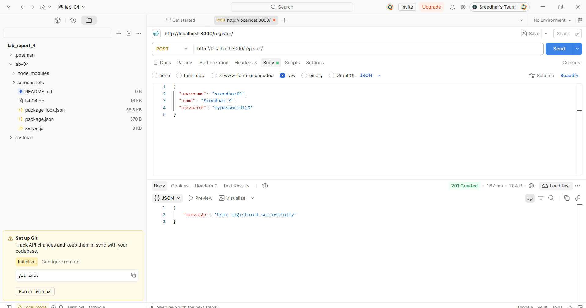
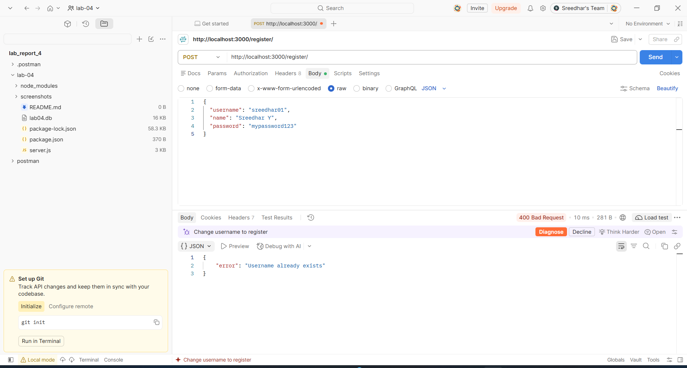
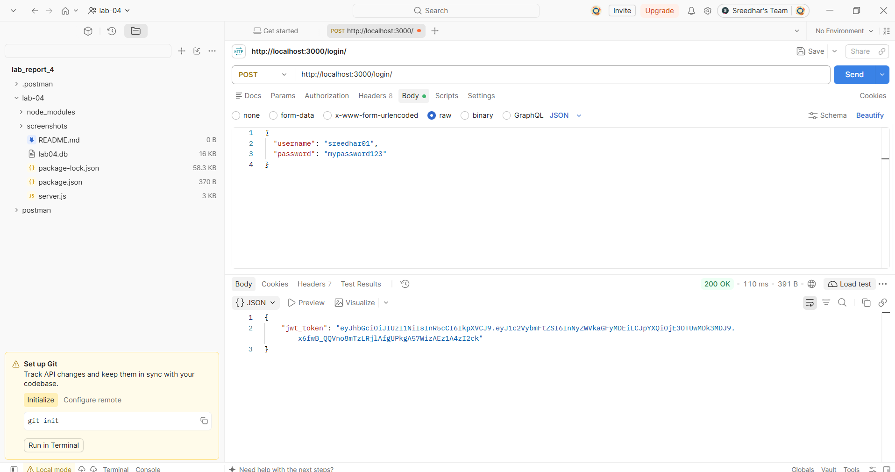
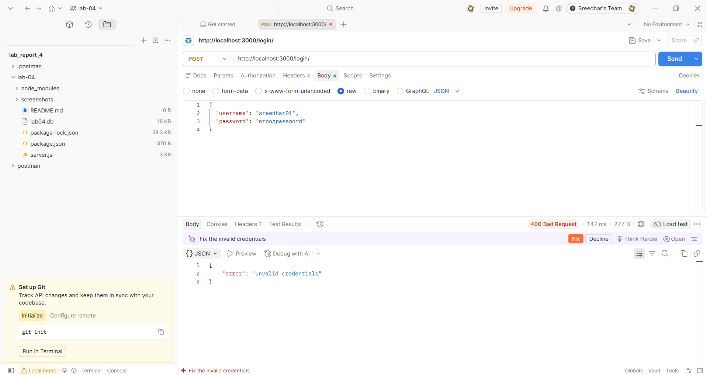

# Lab 4: Registration, login and JWT
**Name:** Sreedhar Yanamala 
**Registration number:** 252U1R1260 
**Section:** CSE-2E 

**Live link:** (https://lab-4-d8j7.onrender.com/)

## How to run
1. Install dependencies: `npm install`
2. Environment variables: None required for this lab (JWT secret is hardcoded in the script).
3. Start the server: `node server.js`

## Endpoints / scripts table
| Method | Path | Description |
| :--- | :--- | :--- |
| POST | `/register/` | Creates a new user, hashes the password with bcrypt, rejects duplicate usernames with a 400 error. |
| POST | `/login/` | Verifies credentials with bcrypt, returns a JWT token on success, returns 400 for invalid users/passwords. |

## Screenshots

**1. Successful Registration**

**2. Failed Registration (Duplicate Username)**

**3. Successful Login (Returns JWT)**

**4. Failed Login (Wrong Password)**

## Notes
* **Problems faced:** Ensuring the JWT payload only contained the username and keeping the password secure, plus handling the Render `sqlite3` deployment environment error.
* **How you solved them:** Used `bcrypt.hash` before storing the user, mapped only `user.username` into the `jwt.sign` payload, and rebuilt `sqlite3` from source on Render using `npm rebuild sqlite3 --build-from-source`.